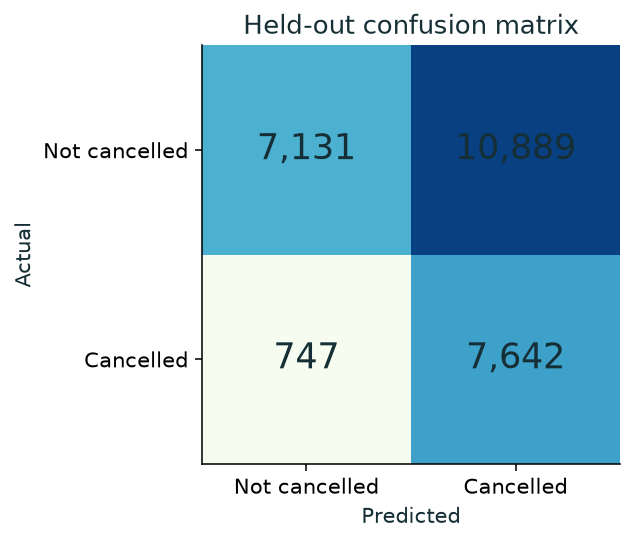
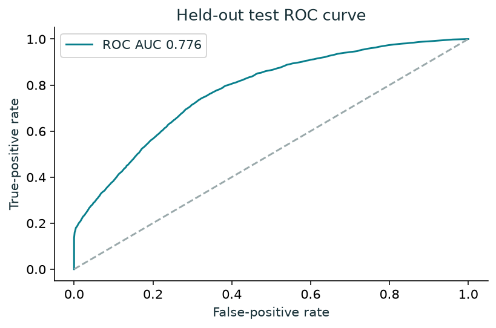
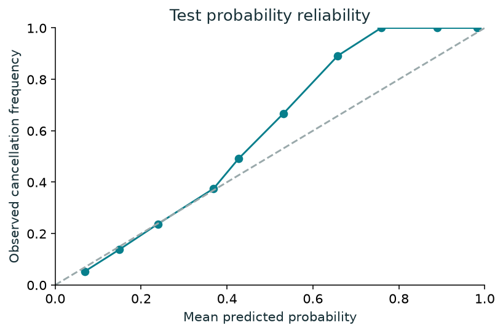
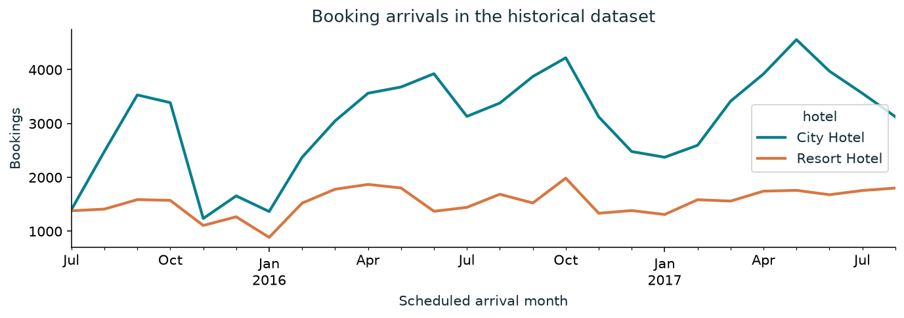
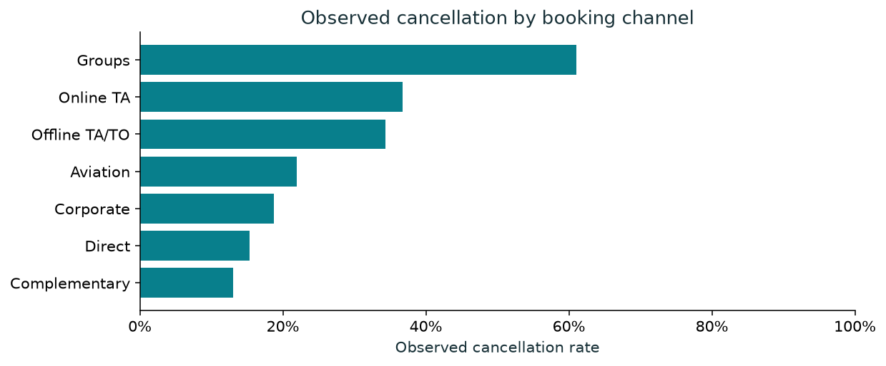
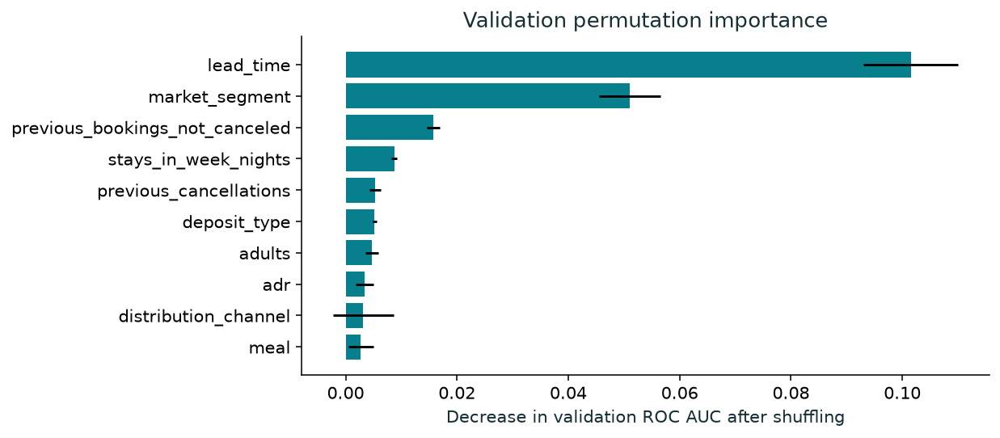

# Booked or Cancelled?
## Predicting Hotel Booking Cancellations and Discovering Booking Patterns

VSEC Data Science Laboratory mini project. B.Tech Information Technology, Second Year.
Pimpri Chinchwad College of Engineering, Pune. Faculty: JYOTI MANOORKAR Ma'am.

### Team

- Pratik Deepak Phapale (PRN 125B1F210)
- Swastik Sandipkumar Phapale (PRN 125B1F212)
- Nirjar Rupesh Patil (PRN 125B1F206)

## Abstract

This project studies hotel cancellations as a binary classification problem and explores historical booking patterns. It combines an interactive Streamlit GUI, reproducible Python pipelines, a real public dataset and an executed notebook. The source contains 119,390 bookings, of which 37.0% have a cancellation outcome. A fixed chronological protocol compares logistic regression, random forest and gradient boosting with a majority-class baseline. Random forest has the highest validation ROC AUC and achieves test ROC AUC 0.776. At the validation-selected threshold of 0.16, test precision is 41.2%, recall is 91.1% and F1 is 0.568. These results describe a historical cohort rather than verified performance at a current hotel.

## 1. Problem statement and objectives

Hotels need to understand cancellation patterns and prioritize reservations for confirmation. The application estimates whether a booking may be cancelled using information assumed available at creation time. It supports staff review and exploratory analysis. It does not modify reservations, estimate guaranteed revenue, forecast occupancy, or equate non-cancellation with attendance.

The objectives are to clean and inspect data, visualize observed patterns, compare multiple algorithms, evaluate future-period errors, and provide single and batch prediction through a usable GUI. The positive target is is_canceled = 1. The negative target includes records marked No-Show, so “not cancelled” must not be renamed “checked in.”

## 2. Dataset and attribution

The original work is Antonio, N., de Almeida, A. and Nunes, L. (2019), Hotel booking demand datasets, Data in Brief 22, 41–49. DOI: https://doi.org/10.1016/j.dib.2018.11.126. The data describe a resort hotel and a city hotel in Portugal, with arrivals from July 2015 through August 2017. The combined CSV is provided by the TidyTuesday mirror (https://github.com/rfordatascience/tidytuesday/tree/main/data/2020/2020-02-11), prepared by Thomas Mock and Antoine Bichat. The original data article uses CC BY 4.0. The local raw file is unchanged. Retrieval and checksum details appear in data/provenance.json.

Raw SHA-256: 7c2ae42a7353905ea136e5c2287f17c92c5435826598bfbb8491c6f0c7b1fc06

The modelling subset contains 118,564 overnight bookings. We exclude 826 records with zero guests, zero nights, invalid dates or negative prices. Children has a small number of missing values and uses a median learned on training data. Categorical missing values use the most frequent training category. We retain 31,994 exact duplicate-looking rows because the dataset has no booking ID to distinguish repeated snapshots from separate similar reservations. Dependence between bookings remains a limitation.

## 3. Methodology

Booking creation date is approximated as arrival date minus lead_time. Training bookings begin before 1 September 2016, validation bookings begin from September through December 2016, and test bookings begin in January 2017 or later. For earlier partitions, planned checkout and the final recorded status date must precede the next period. This avoids making an earlier model depend on labels that were still unresolved. It leaves 26,089 otherwise eligible observations outside these mature cohorts and can reduce representation of long-lead reservations.

| Partition | rows | cancellation_rate | start | end |
| --- | --- | --- | --- | --- |
| train | 57745 | 0.3583 | 2014-03-18 | 2016-08-30 |
| validation | 8321 | 0.2351 | 2016-09-01 | 2016-12-30 |
| test | 26409 | 0.3177 | 2017-01-01 | 2017-08-31 |

The predictor uses 19 numeric and categorical features. Numerical values use training-only median imputation and scaling. Categorical values use training-only mode imputation and one-hot encoding, with unknown categories ignored. The same feature transformation and fitted pipeline serve the GUI and batch inputs. The test set never determines model choice or threshold. The fitted model remains trained on the training partition so the reported evaluation corresponds to the distributed artifact.

Model choice maximizes validation ROC AUC. A tie uses lower validation Brier score. Thresholds from 0.10 through 0.90 in increments of 0.01 are compared on validation F1, with documented tie breaks. The chosen threshold is 0.16. The GUI allows another review threshold without changing model probabilities. This does not imply the F1 optimum matches every hotel’s operational costs.

Outcome status, final status timestamp and later modification fields cannot enter the predictor. Final timestamps have a separate, evaluation-only label-availability role. The selected fields, including ADR, deposit rules and guest history, are assumed to have booking-time values; the source does not supply immutable point-in-time snapshots to verify this assumption. The experiment is not proof that all temporal leakage has been eliminated.

## 4. Algorithms and results

The experiment uses a majority-class DummyClassifier, logistic regression, a 140-tree random forest and histogram gradient boosting. Random seed is 42. The comparison table uses threshold 0.50 for all models so those rows are directly comparable.

| model | validation_roc_auc | test_roc_auc | test_accuracy | test_precision | test_recall | test_f1 | test_brier_score |
| --- | --- | --- | --- | --- | --- | --- | --- |
| Majority baseline | 0.5000 | 0.5000 | 0.6823 | 0.0000 | 0.0000 | 0.0000 | 0.3177 |
| Logistic regression | 0.6625 | 0.7466 | 0.7340 | 0.9103 | 0.1802 | 0.3009 | 0.1754 |
| Random forest | 0.6951 | 0.7762 | 0.7338 | 0.9607 | 0.1689 | 0.2873 | 0.1678 |
| Gradient boosting | 0.6691 | 0.7785 | 0.7406 | 0.7758 | 0.2578 | 0.3870 | 0.1661 |

Selected model at its validation-selected threshold:

| Metric | Result |
| --- | --- |
| Accuracy | 0.5594 |
| Balanced Accuracy | 0.6533 |
| Precision | 0.4124 |
| Recall | 0.9110 |
| F1 | 0.5678 |
| Roc Auc | 0.7762 |
| Average Precision | 0.6509 |
| Brier Score | 0.1678 |

The confusion matrix uses rows for actual and columns for predicted outcomes, ordered not-cancelled then cancelled. A false positive flags a booking that remains uncancelled. A false negative misses a booking that cancels. Precision measures the fraction of flags that really cancel. Recall measures the fraction of cancellations detected. ROC AUC evaluates ranking across thresholds. Average precision is informative with an imbalanced target. Brier score measures probability error, and the reliability chart shows whether estimated probability bands match observed frequencies. No calibration correction has been fitted.

## 5. Booking-pattern discovery

The GUI filters the complete source history by hotel and arrival year. It compares booking channels, lead-time bands, deposit types, repeat status, customer types and stay length. Every rate displays sample counts and can suppress small groups. Wilson 95% intervals describe sampling uncertainty under an independence assumption. They do not account for dependence between related bookings.

| hotel | bookings | cancellations | cancellation_rate |
| --- | --- | --- | --- |
| City Hotel | 79330 | 33102 | 0.4173 |
| Resort Hotel | 40060 | 11122 | 0.2776 |

The period contains partial years. Monthly volume can reflect coverage as well as seasonality. Cancellation differences by deposits and channels are associations and may reflect commercial policy. They are not evidence that changing a deposit causes the same change in cancellation risk. Feature importance also measures predictive dependence, not causal effect or an individual guest’s reason for cancelling.

## 6. Software architecture and GUI

The data layer loads the unchanged CSV and constructs dates. The feature layer validates inputs and enforces a column allowlist. The training layer fits and compares complete scikit-learn pipelines. Artifacts store the selected pipeline, metrics, version information and checksums. The GUI caches immutable data and model resources, then provides six views: Overview, Booking patterns, Predict a booking, Batch predictions, Model lab and Project guide.

Single prediction uses a form with stay, price, booking and history fields. Batch scoring accepts a UTF-8 CSV containing the supplied template columns, rejects invalid rows with useful error messages, and preserves input row numbers. Exports contain probabilities, predictions, flags and the threshold. Unknown categories receive an explicit notice. Extra outcome columns are ignored. Arbitrary guest identifiers are not echoed into output. Formula-like strings are escaped in spreadsheet-oriented CSV downloads. The GUI accepts no model files.

## 7. Testing and reproducibility

Automated tests cover date and numeric validation, unknown categories, invalid stays, outcome-field invariance, consistent batch scoring, threshold changes and temporal partition constraints. Streamlit AppTest exercises all six pages, form submission, batch examples, empty filters and evaluation views. The notebook executes analysis cells using a kernel tied to the current Python environment. Model and raw-data hashes are recorded. Tests are run separately from report generation; reports do not imply that a skipped test succeeded.

Reproduce with SETUP.bat, then START_PROJECT.bat. To rebuild: python train.py, python scripts/build_deliverables.py, and python -m pytest -q from the project environment. Package versions are recorded in requirements-lock.txt and artifacts/metadata.json. Once dependencies, raw data and model artifacts are present, normal analysis and prediction work offline.

## 8. Limitations and future work

The hotels, geography, historical period and commercial policies are narrow. Neither current Indian hotels nor new hotel chains have been evaluated. Final-record data do not prove booking-time availability for every field. The proxy creation date has day-level precision. Earlier mature-cohort filtering and missing booking identifiers limit representativeness and independence. Estimated probabilities are uncalibrated and should not be treated as certainty. No prospective operating trial or causal intervention was performed.

Future work should collect immutable booking snapshots, stable anonymized booking IDs and timestamped outcomes. Evaluate rolling origin periods and genuinely separate hotels, then calibrate probabilities on a separate calibration partition. Follow-up costs and missed-cancellation costs could inform an operational threshold. A real deployment needs appropriate data handling and policy checks before connecting to a PMS.

## 9. Conclusion

The project delivers a functioning cancellation classifier and an interactive way to inspect booking patterns. Its value is the complete, reproducible workflow and explicit interpretation of model errors. The results show useful historical ranking performance while leaving the limitations visible.

## References

1. Antonio, de Almeida and Nunes (2019). Hotel booking demand datasets. https://doi.org/10.1016/j.dib.2018.11.126
2. TidyTuesday, 11 February 2020. https://github.com/rfordatascience/tidytuesday/tree/main/data/2020/2020-02-11
3. scikit-learn, Common pitfalls. https://scikit-learn.org/stable/common_pitfalls.html
4. scikit-learn, Model evaluation. https://scikit-learn.org/stable/modules/model_evaluation.html
5. Streamlit documentation. https://docs.streamlit.io/
